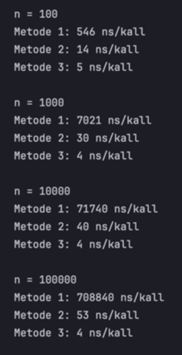
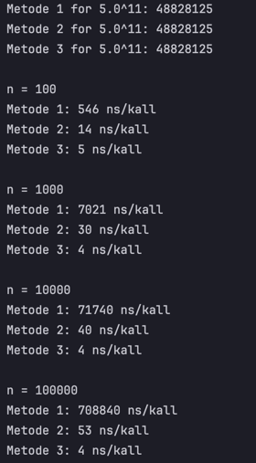

# Øving 2 

Måler x opphøyd i n på 3 måter:
- Metode 1 reduserer eksponenten med 1 i hvert rekursive kall.
- Metode 2 halverer eksponenten i hvert rekursive kall.
- Metode 3 bruker C++-funksjonen `std::pow()`.

### Kontrolltesten
Programmet ble testet med:

- x = 5.0
- n = 11

Alle metodene ga samme resultat:

`48828125`

Som er riktig verdi for 5^11.

### Tidsmåling

Hver metode ble kjørt 1000 ganger for hver verdi av n.
Tiden ble målt med `std::chrono::steady_clock`, og resultatet
viser gjennomsnittlig antall nanosekunder per kall.

Resultater fra kjøringen:

### Asymptotisk analyse

#### Metode 1

Metode 1 reduserer n med 1 for hvert rekursive kall:

T(n) = T(n - 1) + Θ(1)

Det utføres omtrent n rekursive kall. Kjøretiden blir derfor:

Θ(n)

Dette stemmer med målingene. Når n tidobles, blir kjøretiden
omtrent ti ganger så lang.

#### Metode 2

Metode 2 halverer eksponenten for hvert rekursive kall. Rekurrensligningen blir:

T(n) = T(n/2) + Θ(1)

Her er:
- a = 1 
- b = 2 
- k = 0 

Vi sammenligner a med b^k:

b^k = 2^0 = 1 = a

Siden a = b^k (tilfelle 2 i mestermetoden), blir løsningen:
 
Θ(log n)

Dette stemmer med målingene. Selv om n økte fra 100 til 100 000,
økte kjøretiden bare fra 14 til 53 nanosekunder per kall.

#### Metode 3

Metode 3 bruker `std::pow()` Den var klart raskest i disse målingene med nulll endringer i tidsforbruk fra 1000 til 100000.

### Konklusjon

Målingene viser en tydelig forskjell mellom de to rekursive
metodene. Metode 1 har lineær kjøretid, Θ(n), mens metode 2 har
logaritmisk kjøretid, Θ(log n). Metode 2 er derfor betydelig
raskere når n blir stor.

Full utskrift ved kjøring av programmet:

