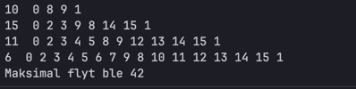

# Øving 5 Petter Birkelund-Jensen

Vektede grafer: maksimal flyt med Edmonds-Karp

## Implementasjon (maksflyt.cpp)

- **Innlesing (`readGraph`):** leser nodantall, kantantall og kantene (`fra til kapasitet`) fra graffilen. Kapasitetene legges i en nabotabell `cap[x][y]`. Kantene leses inn i en liste først, og skrives så inn i tabellen i to omganger: først alle ekte kanter, deretter motkanter med kapasitet 0 der det ikke finnes en ekte kant fra før. Dette bevarer begge retningene i grafer med toveiskanter (flytgraf3 og flytgraf4 har slike).
- **BFS (`bfs`):** bredde-først søk fra kilden over nabotabellen. En kant `x -> y` følges bare hvis restkapasiteten `cap[x][y] - flow[x][y] > 0`. Returnerer forgjenger-tabellen. 
- **Hovedløkke (`main`):** kjører BFS, spenner veien sammen baklengs via forgjengerne, finner flaskehalsen (minst restkapasitet langs veien), øker flyten med flaskehalsen langs veien og trekker den samme fra i motsatt retning (`flow[y][x] -= bottleneck`). Gjentar til BFS ikke finner flere veier. Skriver ut hver økning og veien, og totalen til slutt.
- Kilde og sluk tas som kommandolinjeargumenter etter graffila.

## Resultater

| Graf | Kilde | Sluk | Maksimal flyt | Antall flytøkende veier |
|---|---|---|---|---|
| flytgraf1 | 0 | 7 | 10 | 8 |
| flytgraf2 | 0 | 1 | 27 | 4 |
| flytgraf3 | 0 | 1 | 42 | 4 |
| flytgraf4 | 0 | 7 | 11 | 8 |
| flytgraf5 | 0 | 7 | 90 | 5 |

flytgraf1, flytgraf2 og flytgraf4 stemmer med fasit-tabellen i oppgaven (10, 27 og 11).

### Utskrift flytgraf3 (kilde 0, sluk 1)

### Utskrift flytgraf5 (kilde 0, sluk 7)

